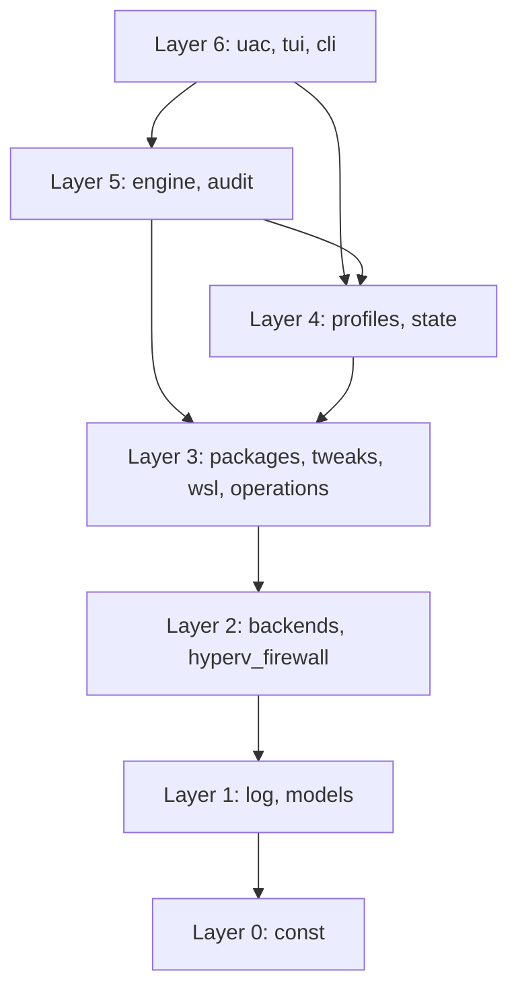
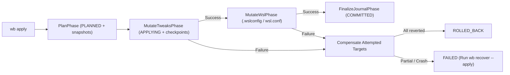

# Architecture & Public API Policy

`winbearable` (`wb`) is a native-Python Windows 11 (`26H2+`, Build `>= 26300`) and WSL2 configuration, hardening, and posture-audit tool. Its architecture is built around four core design goals:

1. **Zero PowerShell for Core Tweaks:** Registry, Win32 API, and native executable operations use `winreg`, `ctypes`, and `subprocess.run(..., shell=False)` so core functionality works even under corporate AppLocker/WDAC Constrained Language Mode. The sole PowerShell exception is `src/winbearable/hyperv_firewall.py`, which invokes a pinned `-File` script (`scripts/hyperv_firewall.ps1`) verified by SHA-256 and parses bounded JSON.
2. **Strict Acyclic Layering:** Modules are organized into a 7-layer DAG enforced by `tests/test_catalog_lint.py`, preventing circular dependencies and keeping rollback/compensation isolated from apply logic.
3. **Preview & Crash-Consistent Transactions:** Mutating operations record pre-change snapshots in a locked, DACL-protected write-ahead journal (`state.json`) before touching the OS, with deterministic mid-run compensation and `wb recover --apply`.
4. **Fast CLI Startup:** `winbearable.__init__` and `winbearable.cli.__init__` use PEP 562 `__getattr__` lazy loading and lightweight `cli/schemas.py` so `wb --help` and `wb --version` avoid importing the full backend/catalog graph.

---

## Layered Dependency DAG

`tests/test_catalog_lint.py` enforces a strict 7-layer acyclic dependency graph from foundation (`Layer 0`) to user interfaces (`Layer 6`). Higher layers may import from lower layers, never the reverse.

| Layer | Modules | Responsibility |
| --- | --- | --- |
| `0` | `const` | Package version (`__version__`), schema versions (`JSON_SCHEMA_VERSION`, `STATE_SCHEMA_VERSION`, `PROFILE_SCHEMA_VERSION`), exit codes, build/edition policy constants, and env override gating. |
| `1` | `log`, `models` | Structured JSON logging (`JsonLogFormatter`, secret/username redaction) and pure domain models (`EnvironmentInfo`, `ProfileSpec`, `RunRecord`, snapshots, aliases, error hierarchy). |
| `2` | `backends`, `hyperv_firewall` | Registry/System capability ports (`backends/ports.py`), native `winreg`/Win32/subprocess backends, in-memory fakes for testing, ACL/SDDL verification (`backends/win32_acl.py`), and bounded PowerShell JSON protocol. |
| `3` | `packages`, `tweaks`, `wsl`, `operations` | Immutable `mappingproxy` tweak and winget package catalogs, declarative parameter schemas, WSL config/INI/lifecycle management, canonical target identity, and single `OPERATION_KIND_SPECS` registry. |
| `4` | `profiles`, `state` | Untrusted TOML/JSON profile validation (with root-contained `include` resolution) & schema migration, plus locked/ACL-protected `StateStore` with write-ahead journal and transaction-aware backup retention. |
| `5` | `engine`, `audit` | Profile evaluation (`evaluate_profile`), phased execution (`PlanPhase` -> `MutateTweaksPhase` -> `MutateWslPhase` -> `FinalizeJournalPhase`), rollback/recovery compensation, hardening score calculation, and read-only posture checks. |
| `6` | `uac`, `tui`, `cli` | Explicit UAC elevation target resolution (`-I`, SID verification, env sanitization, DACL-safe `%TEMP%` output), optional Textual TUI, and `wb` CLI parser/handlers/renderers. |

---

## Capability Ports & Operation Adapters

To keep tweak execution decoupled from concrete OS implementations and easy to test with in-memory fakes:

- **Narrow Capability Ports (`src/winbearable/backends/ports.py`):** Concrete operation adapters (`package_and_file_adapters.py`, `service_task_feature_adapters.py`, `security_policy_adapters.py`, `env_adapters.py`) depend on narrow protocol ports (such as `RegistryBackend`, `AclPort`, `ServicePort`, `ScheduledTaskPort`, `FeaturePort`, `PackagePort`, `ProcessPort`) rather than the full `SystemBackend` god-object.
- **Single Operation Registry (`src/winbearable/operations/registry_spec.py`):** `OPERATION_KIND_SPECS` defines the canonical `APPLY_KIND_ORDER` and validates adapter registration at import time via `validate_operation_registry()`.
- **Canonical Target Identity:** Registry targets normalize `/` to `\` in `registry_value_id` and `registry_key_id` so snapshot matching and compensation are deterministic.
- **Policy-Conflict Honesty:** When an MDM/Intune or Group Policy key conflicts with a tweak's target, detection returns `TweakStatus.BLOCKED_BY_POLICY` and skips mutation rather than attempting to bypass policy.

---

## Phase & Transaction Journal Contract

Every mutating `wb apply` run executes through four explicit phases backed by `StateStore` (`%LOCALAPPDATA%\winbearable\state.json`):

1. **`PlanPhase`:** Validates the profile (`validate_profile_spec`), acquires the cooperative `StateStore` lock, creates a `PLANNED` `RunRecord` with pre-apply snapshots, and exports `.reg` hive backups (for admin runs) before any OS mutation.
2. **`MutateTweaksPhase`:** Transitions the journal to `APPLYING`, executes operation adapters in `APPLY_KIND_ORDER`, and flushes per-operation checkpoints. Any failure triggers immediate compensation of attempted targets (skipping unmutated targets where `post_existed is None` and current state already matches the pre-apply snapshot).
3. **`MutateWslPhase`:** Applies host `.wslconfig` / per-distro `/etc/wsl.conf` / Hyper-V firewall changes after recording `WslDistroSnapshot` and `.wslconfig.bak`. Internal Docker Desktop distros (`docker-desktop`, `docker-desktop-data`) are excluded.
4. **`FinalizeJournalPhase`:** Transitions cleanly to `COMMITTED` (or `ROLLED_BACK` / `FAILED`). Incomplete (`PLANNED`, `APPLYING`, `ROLLING_BACK`, `FAILED`) runs block new mutating applies and are repaired deterministically via `wb recover --apply`.

- **Backup Lifecycle:** `StateStore` maintains `state.json.bak` on every atomic write, rotates completed runs above 100 entries, and prunes `.reg` backup directories above 50 completed runs while never pruning incomplete transactions or snapshot-referenced backups.
- **Compensation Layering:** `rollback` and `recover` depend only on compensation/snapshot primitives and never import `engine/apply.py` (enforced by AST tests).

---

## Security Boundaries & Trust Model

- **Profile Containment:** Profile `include` / `extends` paths are resolved relative to trusted profile roots; path traversal (`../`) raises `ProfileValidationError`.
- **File & ACL Containment:** `FileSpec` and `icacls` operations enforce target path containment (e.g., blocking writes to `C:\Windows\...` with `PermissionDeniedError`).
- **State-Store DACL & Identity Checks:** On Windows, `StateStore` enforces a protected SDDL/DACL (`SYSTEM`, `BUILTIN\Administrators`, current user SID), rejects permissive ACEs (`Everyone`, `Users`, `Authenticated Users`), and verifies `os.lstat`/`os.fstat` file identity on open.
- **UAC Elevation Hygiene:** `uac/elevation.py` validates elevation targets against symlinks/reparse points, strips `PYTHON*` runtime-injection variables and `WINBEARABLE_*_OVERRIDE` / `WINBEARABLE_DEBUG` knobs before spawning elevated children, passes `-I` for non-frozen Python, and relays output via a DACL-restricted `%TEMP%` directory with caller SID verification.
- **Debug Override Gating:** `WINBEARABLE_ADMIN_OVERRIDE` and `WINBEARABLE_BUILD_OVERRIDE` are honored only in non-frozen, non-elevated processes when `WINBEARABLE_DEBUG=1` is explicitly set.

---

## Public API & Compatibility Guarantees

- **Supported Python Import Surface:** `winbearable.__all__` in `src/winbearable/__init__.py` (verified by `tests/cli/test_api_stability_and_workflows.py`).
- **Supported CLI & JSON Contracts:** `wb` subcommands (`doctor`, `status`, `plan`, `apply`, `rollback`, `recover`, `init`, `list`, `show`, `schema`, `migrate`, `audit`, `tui`, `wsl`) and `JSON_SCHEMAS` (`JSON_SCHEMA_VERSION = "2.0"`), plus `STATE_SCHEMA_VERSION = 2` and `PROFILE_SCHEMA_VERSION = 2` with backwards-compatible `wb migrate`.
- **Internal Modules:** Submodules under `backends/`, `operations/`, `engine/`, `uac/`, and `cli/` not re-exported in `winbearable.__all__` are internal implementation details.

---

## Module Size & Catalog Governance

- **Module Size Caps:** Production modules under `src/winbearable/` are capped at `600` LOC, and category tweak modules under `src/winbearable/tweaks/categories/` are capped at `350` LOC (enforced by `tests/test_catalog_lint.py`).
- **Immutable Catalogs:** `TWEAK_CATALOG` and winget package catalogs are wrapped in `types.MappingProxyType` and validated at import/test time.
- **Verification Matrix Enforcement:** Non-registry catalog tweaks must have corresponding entries in `docs/verify-matrix.md` (enforced by `tests/test_catalog_lint.py`).
